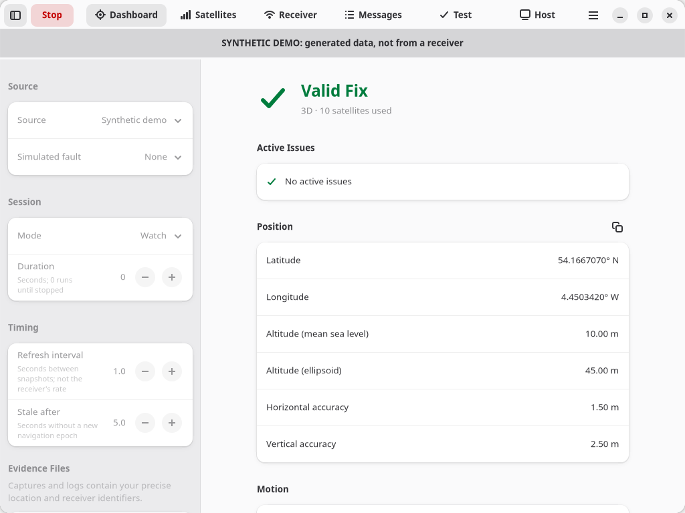
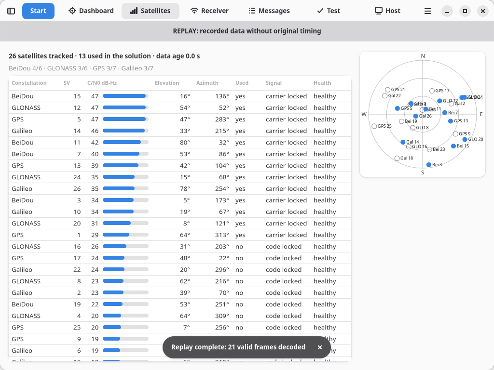
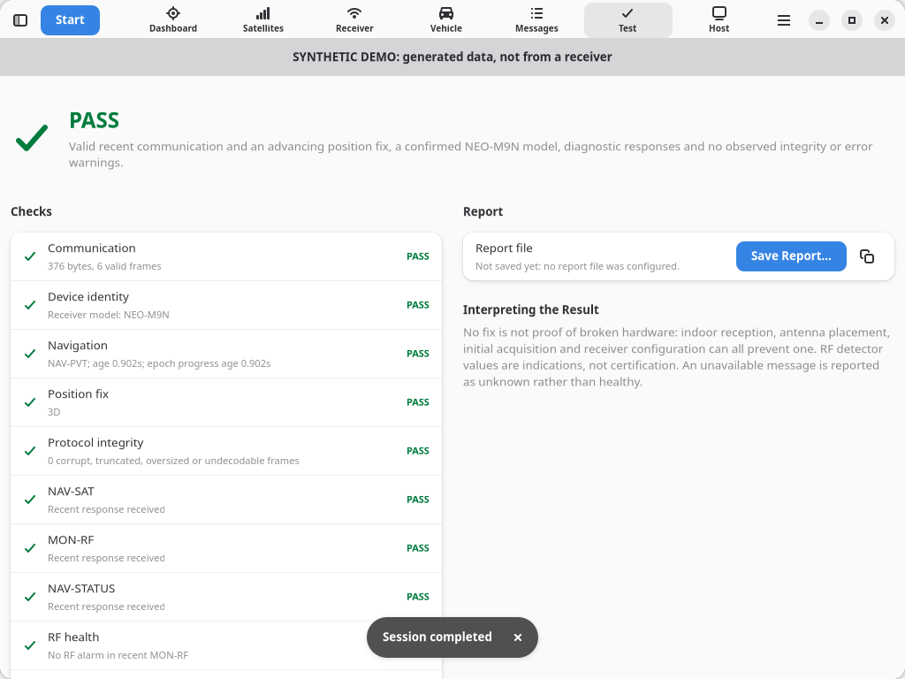

# NEO-M9N Monitor

A GNOME desktop application (GTK 4 + libadwaita) that tests a SparkFun u-blox NEO-M9N connected directly over USB and shows live GNSS data. It gives explicit evidence for USB/serial failures, unavailable diagnostics, loss of fix, frozen navigation epochs, checksum failures and receiver-reported RF or firmware errors.



**Linux only, Python 3.10+, GTK ≥ 4.12, libadwaita ≥ 1.5.** There are no pip runtime packages, cloud services, Arduino, gpsd or u-center, and **no network connections unless you switch the Map page to Online** (see [Privacy](#privacy)). The app targets Fedora Workstation/Server (40 or newer) and runs straight from a checkout. It uses the kernel USB tty, normally `/dev/ttyACM0`.

The receiver is only sent empty-payload UBX diagnostic polls. The app never changes GNSS configuration, resets the receiver or writes flash, and **Passive** mode sends nothing at all. Which diagnostics are available depends on firmware, USB protocol configuration and antenna supervisor wiring.

> Version 2.0 replaced the earlier command-line tool with this application. See [CHANGELOG.md](CHANGELOG.md), including what replaces scripted use.

**New here?** The [project wiki](https://github.com/PurpleSentinel/neo-m9n-ui/wiki) has step-by-step guides: [installation](https://github.com/PurpleSentinel/neo-m9n-ui/wiki/Installation), [getting started](https://github.com/PurpleSentinel/neo-m9n-ui/wiki/Getting-Started), [device test results](https://github.com/PurpleSentinel/neo-m9n-ui/wiki/Device-Test-Results), [troubleshooting](https://github.com/PurpleSentinel/neo-m9n-ui/wiki/Troubleshooting) and an [FAQ](https://github.com/PurpleSentinel/neo-m9n-ui/wiki/FAQ).

## Quick start on Fedora

```bash
git clone https://github.com/PurpleSentinel/neo-m9n-ui.git
cd neo-m9n-ui
sudo dnf install python3 python3-gobject gobject-introspection gtk4 libadwaita
python3 scripts/install-user.py
```

Open **NEO-M9N Monitor** from Activities, or run `~/.local/bin/m9n`. Without installing, run `python3 -m m9n` from the checkout. Remove it again with `python3 scripts/install-user.py --uninstall`. `bash scripts/install-fedora.sh` installs the packages above plus the optional host tools (`usbutils util-linux psmisc`) and then the app. See [Fedora installation and USB access](docs/FEDORA.md) for permissions, Atomic desktops and pip.

Connect the GNSS board's USB port using a **USB data cable**, attach the right antenna and give it an open view of the sky. A USB-C plug does not guarantee the cable carries data. SparkFun's MicroMod Function Board variant also needs its Main Board powered separately; see [hardware notes](docs/HARDWARE.md).

1. Open the **Host** page. It should list the u-blox receiver and report read/write access.
2. In the session setup sidebar (F9), keep **Source: USB receiver** and **Receiver: Automatic**, then press **Start** (F5) to watch live data.
3. Press **Run Device Test** (Ctrl+T) for a timed PASS/WARN/FAIL assessment, outdoors for best results.

If access is denied, the Host page shows the commands to run. They install the supplied udev rule, which grants the active local desktop user access to u-blox ttys:

```bash
echo 'SUBSYSTEM=="tty", ATTRS{idVendor}=="1546", TAG+="uaccess", ENV{ID_MM_DEVICE_IGNORE}="1"' | sudo tee /etc/udev/rules.d/70-ublox-gnss.rules
sudo udevadm control --reload-rules
```

Unplug and reconnect afterwards. The app never runs privileged commands itself. For SSH/headless use, see the owning-group instructions in [FEDORA.md](docs/FEDORA.md).

Automatic selection matches u-blox USB vendor ID `1546` and refuses to guess between several receivers; pick one explicitly instead (stable `/dev/serial/by-id/` names are offered). A matching vendor ID is not model authentication: the device test checks the receiver's own `MON-VER` model.

## What you get

| Page | Detail |
| --- | --- |
| Dashboard | Fix status, position, altitude, accuracy, speed, course, DOP, GNSS UTC, sample and epoch-progress age, sunrise, sunset and sun elevation, firmware identity, stream counters and active issues; copy coordinates or the snapshot as JSON |
| Satellites | Every NAV-SAT satellite: constellation, SV, C/N0, elevation, azimuth, use in solution, signal quality, health; sortable; sky plot |
| Receiver | MON-RF antenna/jamming/noise/AGC, NAV-STATUS TTFF/uptime/spoofing indication, diagnostic freshness, unanswered and rejected polls |
| Map | Your live position, accuracy circle and the trip's track, following you: on a coordinate grid (default), on an **offline map file** made once at home (works with no internet), or on an OpenStreetMap map you opt into |
| Vehicle | For use on the move: a speed gauge, a compass showing the course over ground, distance travelled, average and maximum speed, moving time and an altitude profile, in large colourful instruments that scale to the window; km/h or mph; fullscreen (F11) and the screen kept awake |
| Messages | Receiver INF/TXT notices and parser errors for the whole session, and the application log (debug: RX/TX hex); filter, search, copy, save |
| Test | Timed device test with progress and a PASS/WARN/FAIL/INTERRUPTED report you can save and copy |
| Host | USB devices, access, `cdc_acm`, port owners, gpsd/ModemManager, udev properties; replaces `doctor`; save as JSON |

Evidence files (all optional, set in the sidebar): an exact **raw RX capture**, a **JSONL snapshot log** (snapshots plus the final test report), the **application log** and the **test report**. By default they get timestamped names in `Documents/NEO-M9N`; any of them can be pinned to a specific file. Raw captures are never overwritten. **Captures and logs contain your precise location and receiver identifiers**: inspect them before sharing; `captures/`, `reports/`, `*.ubx` and `*.jsonl` are gitignored.




The live views process every incoming frame immediately. Snapshots default to 1 Hz (the **Refresh interval** setting), and NAV-PVT is polled at 1 Hz; faster receiver output is still consumed. A lower refresh interval refreshes the display more often but does not change the receiver's measurement rate. This is a diagnostic tool, not a hard real-time control loop. **Baud rate** only matters for a USB-to-UART adapter; native USB needs no baud search.

## Privacy

The app makes **no network connections** by default. The only exception is the Map page's **Online** mode, which you switch on yourself after a notice explaining what is shared:
- **Sent to the map provider:** OpenStreetMap's tile servers receive your IP address and which map tiles you view. Zoomed in, the tiles show roughly where you are.
- **Never sent:** coordinates, your track, receiver identifiers or evidence files.
- **Only while you're looking:** tiles are requested only for the area on screen, only while the Map page is showing, and never in advance.
- **Cache:** viewed tiles are cached in `~/.cache/neo-m9n/tiles` (with a size limit and **Clear Map Cache**) and used only while online, as OpenStreetMap's tile policy requires.
- **Switching off:** switch the map back to Off at any time.

**Offline map files** give a real map with no network at all. You make one at home for your region with `scripts/make-offline-map.sh` (which downloads OpenStreetMap data, not tiles, and lists every host it contacts first), and the app reads it locally. See the [user guide](docs/USER-GUIDE.md#offline-map-files).

## Device test results

The device test observes the receiver for 60 seconds by default and assesses the latest navigation plus the integrity and error evidence accumulated during the session. Extend it outdoors for a cold start or difficult reception.

| Result | Meaning |
| --- | --- |
| PASS | Valid recent communication and an advancing position fix, a confirmed NEO-M9N model, diagnostic responses and no observed integrity or error warnings |
| WARN | Communication and navigation work, but fix, identity or diagnostic evidence is incomplete, or RF or integrity warnings were observed |
| FAIL | No usable navigation or communication, stale or frozen navigation, an unexpected model, a receiver error, a disconnect or a local I/O failure |
| INTERRUPTED | The test was cancelled (or the app was closed or signalled) before its duration elapsed |



A disconnect during a test produces a FAIL report with a `usb_transport` check. Receivers whose jamming monitor reports state 0 ("unknown or disabled") get **WARN** for RF health rather than PASS; the Receiver page explains this when it applies.

**No fix is not proof of broken hardware.** Indoor reception, antenna placement, initial acquisition and receiver configuration can all prevent a fix. RF detector values are indications, not certification of interference or spoofing, and not proof of an antenna fault. An unavailable message is reported as unknown rather than healthy.

## Clean exit

Stop, closing the window, Ctrl+Q, SIGINT/SIGTERM/SIGHUP, an unexpected error or an unplugged receiver all end the session the same way:
1. Release the tty: restore its settings, drop the exclusive lock and close it.
2. Finish the report.
3. Flush and close every evidence file.

Closing the window while a session runs asks first. Suspend is inhibited while a session runs.

## Try without hardware

Choose **Source: Synthetic demo** (optionally with a simulated fault: no fix, RF alarm, corrupt frames, frozen epochs, silent; or *Moving vehicle*, which drives a loop for the Vehicle page) or **Replay capture** with a saved raw file. Demo data is labelled SYNTHETIC DEMO and replays are labelled REPLAY. To exercise the real tty code path:

```bash
python3 scripts/simulate-device.py --fault no-fix
```

It prints a `/dev/pts/…` path to enter under **Receiver: Other path…**. That tests the software path, not your GNSS module.

More: [wiki](https://github.com/PurpleSentinel/neo-m9n-ui/wiki), [user guide](docs/USER-GUIDE.md), [troubleshooting](docs/TROUBLESHOOTING.md), [architecture](ARCHITECTURE.md), [protocol and data contract](docs/PROTOCOL.md), [validation](docs/VALIDATION.md), [contributing](CONTRIBUTING.md).
