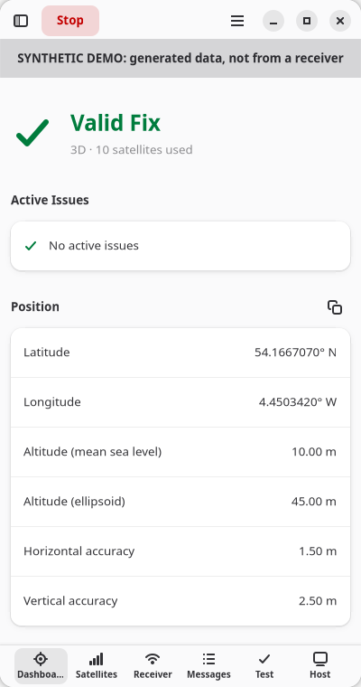
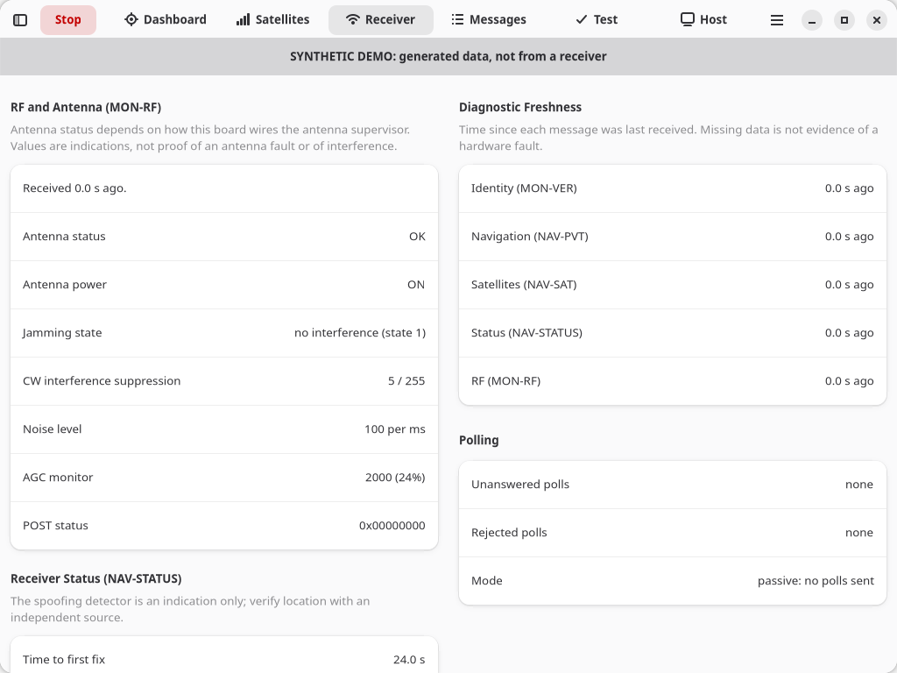
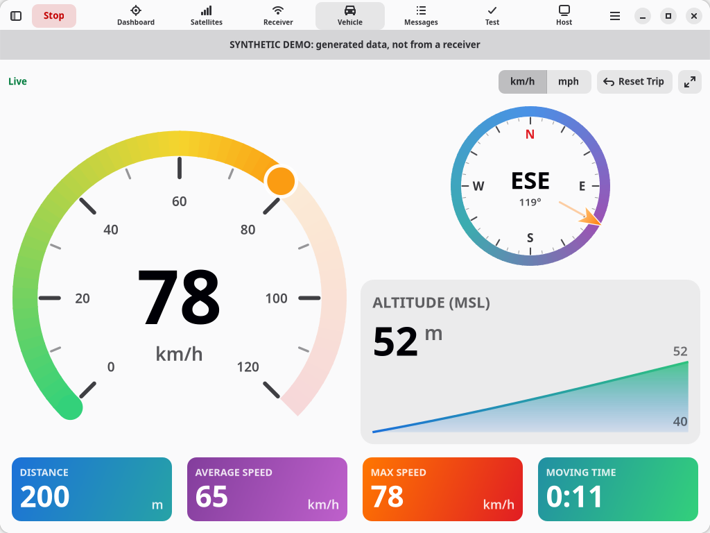
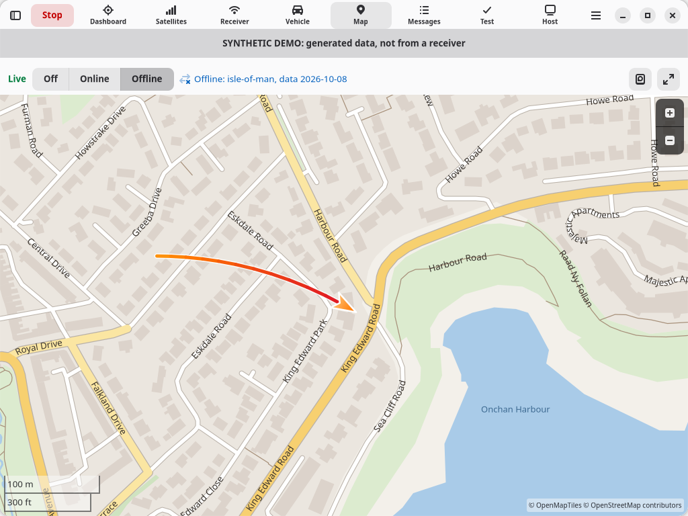
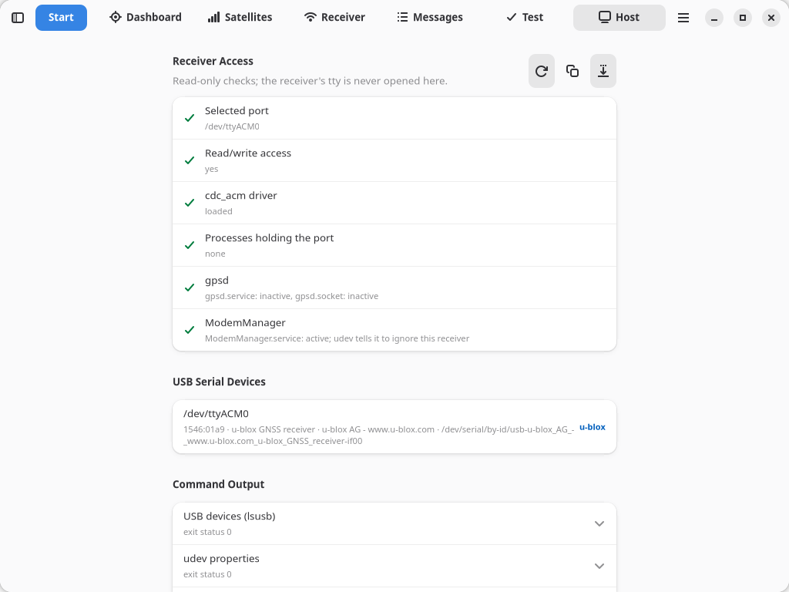

# User guide

NEO-M9N Monitor has a **session setup sidebar** (F9) and eight pages. A *session* reads from one source, a USB receiver, the synthetic demo or a replay file, until you stop it, its duration ends or the receiver disconnects. Only one session runs at a time, and a second launch of the app just brings the existing window forward, so two copies never compete for the receiver.

Pages adapt to the space they get. Dashboard, Receiver, Test and Host lay their groups out in up to three columns: three on a wide page, two on a typical desktop window, one at phone width. Hiding the sidebar (F9) widens the page, so it can gain a column. On Satellites the sky plot sits beside the table when both fit, moves above it when they don't, and grows on large screens.

## Keyboard shortcuts

| Keys | Action |
| --- | --- |
| F5 | Start or stop the session |
| Ctrl+T | Run a device test |
| F9 | Show or hide session setup |
| Ctrl+E | Export the track as GPX |
| F11 | Fullscreen |
| Ctrl+? | Keyboard shortcuts |
| Ctrl+Q | Quit (asks first while a session runs) |

## Appearance and night mode

Choose **Main Menu → Appearance**:
- **Follow System** (default): light or dark, as your desktop is set.
- **Light**
- **Dark**
- **Automatic by Sun:** dark from civil dusk to civil dawn at the receiver's position (the sun more than 6° below the horizon), light otherwise.
  - **How it decides:** it checks once a minute using GNSS time.
  - **No flicker at dusk:** it switches only once the sun is half a degree past the line.
  - **Before a fix:** it looks like the system setting until the receiver has a position.
  - **If the fix is lost:** it keeps its last choice.

The **night mode** button (moon) on the Vehicle and Map pages switches between light and dark with one tap. Using it while *Automatic by Sun* is on switches to plain Light or Dark.

Everything the app draws follows the appearance, including the instruments and offline maps. The choice is saved. Online OpenStreetMap map squares are drawn by OpenStreetMap, so they stay light.

## Session setup

| Group | Setting | Notes |
| --- | --- | --- |
| Source | **Source** | USB receiver, Synthetic demo or Replay capture |
| | **Receiver** | *Automatic* picks the single u-blox (VID 1546) tty and refuses to guess between several. Discovered devices are listed by their stable `/dev/serial/by-id/` name and rescanned every 2 s. *Other path…* accepts any tty path, such as the PTY simulator. |
| | **Simulated fault** | Demo only: no fix, RF alarm, corrupt frames, frozen epochs, silent receiver, a computer clock 42 s fast or 1.5 s slow, or *Moving vehicle* (no fault: drives a 400 m loop at 11–90 km/h with a hill, for the Vehicle page) |
| | **Capture file** | Replay only: a raw RX capture (exact bytes, mixed UBX and NMEA) |
| Session | **Mode** | *Watch* until stopped, or *Device test* |
| | **Duration** | Watch: seconds, 0 = until stopped. Device test: seconds observed (default 60). |
| Receiver | **Baud rate** | termios line setting; only matters for a USB-to-UART adapter. It does not configure the receiver. |
| | **Passive** | Listen only; send no diagnostic polls |
| Timing | **Refresh interval** | Seconds between snapshots (default 1); not the receiver's measurement rate |
| | **Stale after** | Navigation is stale when nothing new arrives, or the epoch stops advancing, for this long (default 5 s) |
| Evidence Files | **Folder** | Where timestamped files go; default `Documents/NEO-M9N`, created when needed |
| | **Raw RX capture** | Exact received bytes, flushed per read, never overwritten (USB source only) |
| | **JSONL snapshot log** | One JSON snapshot per refresh plus the final snapshot or test report; appends |
| | **Application log** | The application log at the chosen verbosity; appends |
| | **Test report** | Final JSON report (device tests only); replaces |
| | **Debug logging** | Adds RX/TX hex and every decoded message to the application log |

Each output is named `m9n-YYYYmmdd-HHMMSS.ubx` / `.jsonl` / `.log` / `-report.json` in the folder. The save button on its row pins it to a specific file instead, for example to keep appending to one JSONL file; the clear button returns to timestamped names. Settings are saved to `~/.config/neo-m9n/settings.json`.

Invalid settings are marked on their row, the reason is shown under the form and **Start stays disabled**. Examples: a replay without a file, a pinned file in a missing folder, an existing raw capture, two outputs sharing a path. The sidebar is locked while a session runs.

## Dashboard

The current fix in large type: **Valid Fix**, **Stale Navigation**, **No Fix** or **Waiting for Navigation**, always with an icon and text rather than colour alone. Below it:
- **Active issues** (also shown briefly as notifications when they appear)
- position, motion, dilution of precision, time
- **Sun:** today's sunrise, sunset, day length and civil twilight (dawn to dusk) at the receiver's position, and the sun's elevation now
  - **Time zone:** times are shown in the computer's time zone, e.g. *07:38 BST*.
  - **Date:** they use the receiver's GNSS date, falling back to the computer's clock only if the receiver hasn't given one. The group's description says which is in use.
  - **Polar regions:** these show *Sun up all day* or *Sun down all day*.
  - **No network:** the times are calculated in the app, accurate to about a minute.
- receiver identity (MON-VER), session details and stream counters

Values the receiver hasn't provided read *unknown*; they are never guessed. Copy the coordinates, or the whole snapshot as JSON, with the copy buttons.

## Satellites

Every satellite from NAV-SAT. By default used satellites come first, then the strongest C/N0; click a column header to sort by it. Scrolling and selection survive each refresh. The sky plot shows azimuth/elevation with used satellites filled in. Satellites whose position the receiver reports as unknown are listed but not plotted. If NAV-SAT is unanswered or rejected, the page says so; that is not evidence of a hardware fault.

## Receiver

- **MON-RF:** antenna status and power, jamming state, CW suppression, noise, AGC and POST status. Antenna supervision depends on how the board wires it, so OPEN/SHORT are indications, not proof of a fault. If the jamming monitor reports state 0 (unknown or disabled), the page explains that a device test will report RF health as WARN.
- **NAV-STATUS:** TTFF, receiver uptime, spoofing detector (an indication only).
- **Freshness:** time since each diagnostic message last arrived, unanswered polls and rejected polls.
- **Computer clock:** how far this computer's clock is from GNSS time, coloured as on the Host page.

## Vehicle

A view to read at a glance on the move, for example on a tablet or laptop in a vehicle. Everything is drawn to scale with the window, from phone width to fullscreen (**F11**):
- **Speed gauge**: the current speed over a green-to-red scale that steps up (0–60, 120, 180 … km/h or 0–40, 80 … mph) so it never pins.
- **Compass**: north-up, with a chevron on the ring marking the **course over ground** and the direction in words (e.g. *ESE 107°*). GNSS heading only exists while moving, so below about walking pace (1 m/s) the compass says *Heading needs movement* instead.
- **Distance**, **average speed**, **max speed** and **moving time** tiles.
- **Altitude** above mean sea level, over a profile of the trip.

Switch between **km/h** and **mph** (also miles and feet) at the top; the choice is saved. **Reset Trip** starts distance, speeds and the profile again. The moon button turns **night mode** on and off (see [Appearance and night mode](#appearance-and-night-mode)). The save button exports the track (see [Exporting the track](#exporting-the-track)). At phone width the fullscreen button is hidden; F11 still works. The trip also restarts with each session.

How the trip is measured: the session counts the great-circle distance between consecutive valid, fresh navigation epochs, using the receiver's time between them. Segments below 0.5 m/s are skipped so a parked receiver's position wander is not counted as travel, and a jump that would need more than 540 km/h is treated as a glitch. The average speed is distance over moving time, so stops don't lower it. After a gap in reception (a tunnel), the straight line between the last and next fix is counted. Distances are as accurate as the positions: expect a few metres per fix, and slightly short on tight bends.

Without a valid, current fix the instruments dim and say **No Fix**, **Stale** or **Waiting**; the last speed is never shown as live. While a session runs and this page is showing, the screen is kept from blanking.

### Exporting the track

**Export Track** (the save button on the Vehicle and Map pages, or **Ctrl+E**) saves the trip's track as a **GPX** file.
- **Where it opens:** Google Earth, OsmAnd, QGIS, Strava, Garmin BaseCamp and most mapping apps.
- **What it contains:** every valid position since the trip started (the session's start or the last **Reset Trip**), with height above sea level, GNSS time, speed and course.
  - **Gaps:** after more than 10 s without a fix (a tunnel), a new track segment starts, so apps don't draw a straight line across the gap.
  - **Points without a valid date:** these are saved without a time, rather than with a wrong one.
- **Where it's saved:** you choose the name and folder. The suggested name is `m9n-track-<date>-<time>.gpx`, in your evidence folder.
- **Privacy:** the file contains your route. It is written only when you export, and never sent anywhere. Apart from the track it records only the app's name and version and the receiver model, nothing about your computer.
- **When it's available:** export also works after **Stop**, until the next session starts. The button is disabled until there is a track, and its tooltip says why.

## Map

Your live position on a map: a marker that becomes an arrow pointing along your course when moving, a translucent circle showing the receiver's accuracy estimate, and the trip's track coloured by speed (green slow, red fast). The map follows you; pan it and it stops following until you press **Re-centre**. The moon button turns **night mode** on and off; offline maps switch to their dark style. The save button exports the track (see [Exporting the track](#exporting-the-track)); at phone width it is hidden, so use the Vehicle page or Ctrl+E. **Reset Trip** on the Vehicle page clears the track, as does a new session. Without a valid, current fix the marker dims and the page says **No Fix**, **Stale** or **Waiting**.

Choose how the map is drawn at the top of the page:
- **Off** (default): the position and track on a coordinate grid, with a scale bar. Nothing leaves your computer.
- **Offline**: a real map from an **offline map file** on your computer (see below). Nothing leaves your computer; this is the mode for a vehicle without internet.
- **Online**: an OpenStreetMap map. The first time, a notice explains exactly what is shared, and nothing changes unless you accept:
  - **Sent:** your IP address, and which map tiles you view (zoomed in, roughly where you are), to OpenStreetMap's tile servers.
  - **Never sent:** coordinates, your track or anything about the receiver.
  - **Visible:** while online, the page shows *Online: OpenStreetMap*.

Online tiles are requested only for the area on screen and only while the Map page is showing: never in the background and never in advance. Viewed tiles are cached in `~/.cache/neo-m9n/tiles`, honouring the server's caching rules, so they aren't downloaded again. **Map storage** (the disk button) shows the cache size and lets you set a limit (default 200 MB) or **Clear Map Cache**. OpenStreetMap does not allow its tiles to be used offline, so the cache is only used while online.

Maps need libshumate (`sudo dnf install libshumate`). Without it the page draws the track on a grid and says how to install it.

### Offline map files

An offline map file holds a whole region's map, made once at home from OpenStreetMap's freely licensed *data* (not its tile servers). The app reads it locally, so the map works with no connection and nothing is sent anywhere.

1. **Make a map, at home:** run `scripts/make-offline-map.sh <area>` from the checkout, for example `scripts/make-offline-map.sh isle-of-man` to try it (a minute or two), or `wales`, `scotland`, `england`, `great-britain`. `--list` explains area names; they are [Geofabrik extract](https://download.geofabrik.de/) names.
   - **How it works:** it runs the free Planetiler converter in a Podman container (`sudo dnf install podman` if needed; Fedora Workstation includes it), pinned to a known version.
   - **What it contacts:** before starting, it lists every host it will contact and asks you to confirm. These are the container registry and the data download sites (Geofabrik, osmdata.openstreetmap.de, Natural Earth, GitHub). They see your IP address and the area you chose.
   - **Output:** the map goes to `Documents/NEO-M9N/maps/<area>.mbtiles`.
   - **Size and time:** a county or small country takes minutes. Great Britain takes longer and needs several GB of free memory and around 10–20 GB of free disk while building. The finished file is much smaller, from a few MB to a few GB.
   - **Progress:** it shows short steps (downloading, reading, writing the map file). Planetiler's full output goes to `~/.cache/neo-m9n/offline-map-build/planetiler.log`; if a build fails, the script shows the end of that log.
   - **Options:** `--dry-run` shows the plan without downloading anything. `--keep-downloads` keeps the roughly 1.3 GB of supporting data for faster rebuilds. `--verbose` shows Planetiler's full output.
2. **Choose it:** on the Map page, open **Map storage** (the disk button), then **Offline map file → Choose…**. The page shows the map's name, data date, zoom range and size.
3. **Use it:** select **Offline**. The page shows *Offline: <name>, data <date>*.

**What you get:**
- **Detail:** roads (with names), places, water, parks and buildings, in a style that follows the app's light or dark appearance.
- **Zoom:** the file has detail up to zoom 14 and is drawn sharper as you zoom further.
- **Outside the file's area:** the page shows the grid with your track and says *Outside offline map*.
- **Updates:** maps don't update themselves; run the script again for newer roads.
- **Remove:** stops using a file without deleting it.
- **Supported files:** vector MBTiles files in the OpenMapTiles schema only; the app explains if a file isn't usable.
- **Attribution:** offline maps show "© OpenMapTiles © OpenStreetMap contributors" as their licence requires.

## Messages

- **Receiver Messages:** INF and NMEA TXT notices, rejected polls and parser errors for the whole session.
- **Application Log:** what the app did. With debug logging this includes the raw RX/TX hex.

Both lists filter by level and search text, keep the newest 5,000 lines, and follow new lines until you scroll up. *Copy* and *Save…* use the visible lines.

## Test

**Run Device Test** (Ctrl+T) switches the setup to a device test and starts it; if the setup is invalid it opens the sidebar and explains why. While it runs you see progress and time remaining, and **Cancel Test** records INTERRUPTED. The result lists every check with its detail. *Host clock* records how far the computer's clock was from GNSS time; it is informational and doesn't change PASS, WARN or FAIL. See the result table in the [README](../README.md#device-test-results).

The report is never lost. The page shows where it was saved; if no report file was configured, or writing it failed, **Save Report…** writes it now. **Copy report JSON** is always available. The window switches to this page when a test finishes.

## Host

Read-only host checks, run when you first open the page and again with Refresh:
- the selected port, read/write access, the `cdc_acm` driver, processes holding the port, gpsd and ModemManager
- the USB serial devices
- raw output of `lsusb`, `udevadm info`, `fuser -v` and `systemctl is-active`

**System Clock** compares this computer's clock with GNSS time during a session, for example *in step (±0.2 s)*, *1.3 s fast* or *42 s slow*. Green is under 0.5 s, amber up to 5 s, and red beyond, with a hint to turn on automatic time. Log and evidence timestamps come from this clock, so a wrong one makes them wrong too. It needs a fully resolved UTC time from the receiver (NAV-PVT, or NMEA RMC or ZDA with a fix), and shows *Waiting for GNSS time* until then. It is the median over the last 30 epochs, stated to ±0.2 s, because USB delivery adds a little delay. Polled NAV-PVT answers can be up to a second old, so with default receiver settings the comparison uses NMEA RMC. A replay isn't compared: its times are from when it was recorded. The app never changes the clock; see [Troubleshooting](TROUBLESHOOTING.md#fixing-a-wrong-clock).

Missing tools are reported, not fatal, and each command is limited to 3 seconds. ModemManager is fine when udev marks the receiver `ID_MM_DEVICE_IGNORE=1`. If access is denied, **Grant Access** lists the udev rule commands to copy; the app never runs privileged commands. The page never opens the receiver's tty, so it is safe while a session runs. *Copy* and *Save as JSON* produce the same document the old `doctor --json` printed.

## Replay and demo

A replay decodes the capture as fast as possible and shows a progress bar (Stop cancels it). A raw capture has no per-read timestamps, so replay can't reproduce the original timing, TTFF or stale intervals: ages describe the decode pass. An empty capture, or one without NAV-PVT/GGA/RMC, is reported explicitly. The synthetic demo emits generated frames once a second, optionally with a fault. Its GNSS time follows this computer's clock, so the clock check reads *in step* unless you choose a clock fault. Both are labelled in a banner so they are never mistaken for live hardware.

## Ending a session

Stop (F5), closing the window, Ctrl+Q, SIGINT/SIGTERM/SIGHUP, an unexpected error and unplugging the receiver all go through the same shutdown:
1. Release the tty.
2. Finish the report (a running test becomes INTERRUPTED).
3. Close every evidence file.

After an unplug, a banner says so; reconnect and start a new session (there is no automatic reconnect). The process exit status after a signal is 128 + the signal number.

## From the command-line tool (1.x)

| 1.x command / option | Now |
| --- | --- |
| `m9n list` | Receiver list in the setup sidebar; *USB Serial Devices* on the Host page |
| `m9n doctor [--json]` | Host page; *Save as JSON* |
| `m9n watch` | *Mode: Watch*, Start |
| `m9n test --duration N --report F` | *Mode: Device test* + *Duration*, or Run Device Test; *Test report* output |
| `m9n demo --fault F` | *Source: Synthetic demo* + *Simulated fault* |
| `m9n replay FILE` | *Source: Replay capture* + *Capture file* |
| `--port`, `--baud`, `--passive` | Receiver, Baud rate, Passive |
| `--interval`, `--stale-after` | Refresh interval, Stale after |
| `--raw-log`, `--json-log`, `--log-file`, `--debug` | Evidence Files switches (pin a file to choose its exact path), Debug logging |
| `--json` stdout | Copy snapshot / report JSON; the JSONL and report files |
| `--plain` | Not applicable |
| Exit codes 0/2/1/130 | The report's `status` and `exit_code` fields (unchanged); no process exit codes |
